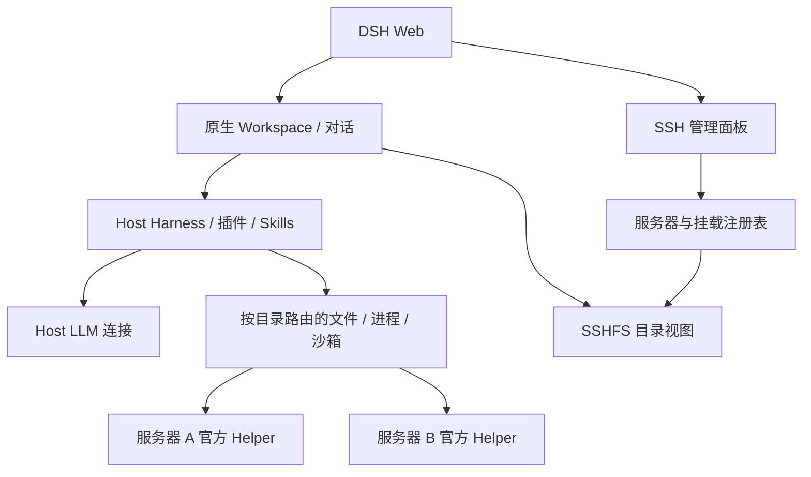

# 架构与实现选择

## 为什么采用 host runtime + SSHFS + 官方 SSH providers

官方 0.2.1-rc.2 已有 `dsh-ssh`、`dsh-fs-ssh`、`dsh-subprocess-ssh` 和 `dsh-sandbox-ssh`。但 `WorkspaceRegistry` 和部分 Web 文件/会话 API 直接调用 host `node:fs`，不能把 `ssh://host/path` 当成原生 workspace。只改一个全局 provider 还会让所有会话落到同一台服务器。

本插件在 host 挂载真实目录，使原生 workspace 与会话机制继续工作；每台服务器建立独立 Cordis provider context，文件/进程调用依据路径选择该 context。不会在每轮对话切换全局服务器，也不会为远程目录创建一个内容为空的假 workspace。

SSHFS 是当前 DSH 本地路径接口的兼容层，不是命令执行后端，也不会把远程 Python/Conda/CUDA 环境搬到 Host。远程执行由独立的 SSH subprocess/sandbox provider 完成。若未来 DSH 的 workspace 和所有相关 Web 文件 API 都支持远程 filesystem provider，才可在保持这些功能的前提下移除 SSHFS。



模型请求、会话日志、skills 发现和插件服务均保留 host 原有实现。普通对话完全没有“远程服务器 → LLM”这条网络依赖。可选 SSH 反向 TCP 隧道仅服务远程程序主动请求 host API 的情况。

## 模块

| 文件 | 责任 |
|---|---|
| `src/index.ts` | Cordis 配置、依赖、HTTP 和路由生命周期 |
| `src/config.ts` | 浏览器输入/持久状态校验 |
| `src/manager.ts` | 多服务器、native provider context、真实挂载检测、持久化、断开和清理 |
| `src/sshfs.ts` | SSHFS 参数；固定 ssh_command 将 SSH 选项交给 OpenSSH，避免进入 FUSE 选项解析 |
| `src/routing.ts` | subprocess/PTY/sandbox 分流、路径变换、连接代际检查、host runtime 例外 |
| `src/sandbox-diagnostics.ts` | 有界只读后端预检、Host/远程定位、保留错误类型并去掉重复包装 |
| `src/fs-routing.ts` | 原生远程文件读写、target 身份映射、同源 sandbox policy、符号链接边界 |
| `src/http.ts` | 复用 dsh 鉴权与 Origin/Host 检查，64 KiB JSON 限制 |
| `src/client.tsx` | 原生 Web panel、服务器/workspace/对话管理 |
| `src/ssh-config.ts` | 有界枚举 Host / Include 候选别名，不执行配置命令或读取私钥 |
| `src/helper-bundle.ts` / `runtime/` | 锁定目标平台依赖、下载并校验 Node、构建及缓存完整运行包 |
| `src/helper-install.ts` | SSH 平台检测、离线安装、全量校验、复用与损坏重装 |
| `src/commands.ts` | 有界进程、字面参数、SSH stdin 流式上传 |
| `scripts/deploy-helper.mjs` | 高级用户手动部署官方 helper archive |

## 自动安装与管理 API

`GET /api/ssh-workspaces/ssh-config` 返回别名候选和读取提示，复用原生登录及 Origin 检查。`POST /servers` 可只传 `host` 和 `label`，默认 auto；旧版有 helper 字段而无 helperMode 的配置仍为 manual。

`POST /servers/:id/connect` 返回 HTTP 202 和当前状态，连接/安装在后台串行队列执行。浏览器每 4 秒读取状态，`setupPhase` 标记检测、准备、上传、校验；浏览器断开不取消任务。状态及错误不写入持久配置，成功安装后的 helper/Node 路径和摘要原子写入 state.json。普通 workspace 增加/挂载路径也会按需自动安装 helper。

安装不修改远端全局环境，不复制 Host 认证配置。Host 的固定 lockfile 与 Node 摘要决定缓存键；远端复用前验证全量文件与原生资源。安装失败不会暴露 connected provider；后续 native SSH 连接失败时，已完整安装的 helper 留待重试。目录用 UUID 区分，损坏或过期目录不被就地覆盖。

## 时延

没有每次命令重新登录、同步整个项目或启动新 dsh 的成本。官方 helper 连接保持存活，程序流使用同一 SSH master 的独立通道，多个 workspace 共享同一服务器的 helper。`grep/glob` 在远程运行 `rg`，不通过 SSHFS 逐个读取文件进行搜索。文件工具走原生 RPC；SSHFS 主要承担 Web 和直接 host 文件访问的兼容视图。

每个 tool 的实际成本仍包括网络 RTT、远程原生 provider 的检查与流分配。循环调用很多小命令会放大往返成本，应合并命令或使用 PTC 批处理。没有提供未经测量的生产时延/吞吐保证；回环测试结果不能外推到跨机房网络。

## 隔离与生命周期

- 一台服务器一个 provider context；一个 workspace 一个随机 UUID 挂载目录。
- 按规范化路径边界和最长匹配路由，不使用字符串前缀近似，不设置全局 currentServer。
- 断线或 mount 状态非 mounted 均拒绝操作；旧文件 target 或已准备沙箱不可跨新连接重用。
- 执行取消、独立 stdout/stderr/control/PTY 和进程树清理由官方 provider/helper 负责。
- 租约 heartbeat 只由官方 `SshConnection` 管理；其协议只有一个独立的在途心跳额度。插件每 10 秒通过只读 `terminal.environment` 查询更新 Web 连接状态，最多一个检查在途。普通 RPC 满载只跳过检查，不误报断线；断开/重连后旧检查不能修改新连接状态。
- 原生模式和沙箱配置原样传递到远程；不会为兼容性自动降为 danger-full-access。
- 服务端 CRUD 串行化，配置临时文件写入后原子 rename，目录 0700、文件 0600。跨多个 dsh 进程共享同一 stateDir 未实现进程间锁，应为不同 profile 配置独立目录。
- 插件不接收私钥、SSH flags 或任意管理 shell。管理 HTTP API 必须通过 host 的 `connection.requestRejection`。

Host 配置示例（profile `cordis.patch.yml`，完整 config 字段）：

```yaml
- id: ssh-workspaces
  config:
    stateDir: /home/USER/.dsh/ssh-workspaces
    mountRoot: /home/USER/.dsh/ssh-workspaces/mounts
    requestTimeoutMs: 30000
    mountTimeoutMs: 20000
    sshfsBinary: sshfs
    helperInstallTimeoutMs: 600000
```

## 官方代码依据

- [SSH 子系统](https://github.com/deepseek-ai/deepseek-harness/blob/687f282e8625c6b8d11ff58211a90524be2e4317/docs/subsystems/ssh.md)
- [SSH provider](https://github.com/deepseek-ai/deepseek-harness/blob/687f282e8625c6b8d11ff58211a90524be2e4317/packages/ssh/ssh/README.md)
- [Helper 构建和平台条件](https://github.com/deepseek-ai/deepseek-harness/blob/687f282e8625c6b8d11ff58211a90524be2e4317/packages/ssh/ssh-helper-runtime/README.md)
- [WorkspaceRegistry 的本地路径处理](https://github.com/deepseek-ai/deepseek-harness/blob/687f282e8625c6b8d11ff58211a90524be2e4317/packages/workspace/workspace/src/index.ts)
- [Web 插件发布](https://github.com/deepseek-ai/deepseek-harness/blob/687f282e8625c6b8d11ff58211a90524be2e4317/docs/user/develop/basic/publish.md)

自动安装相关依据：[OpenSSH ssh_config](https://man.openbsd.org/ssh_config)、[npm 平台覆盖配置](https://docs.npmjs.com/cli/v11/using-npm/config/)、[固定 Node 摘要清单](https://nodejs.org/dist/v24.19.0/SHASUMS256.txt)。

SSHFS 选项依据：[SSHFS 3.7.3 源码](https://github.com/libfuse/sshfs/blob/sshfs-3.7.3/sshfs.c) 中的 `ssh_opts` 白名单、`set_ssh_command` 与 `fuse_new`/`fuse_mount` 顺序，以及 [ssh_command 文档](https://github.com/libfuse/sshfs/blob/sshfs-3.7.3/sshfs.rst)。

心跳与容量依据：[官方协议实现](https://github.com/deepseek-ai/deepseek-harness/blob/687f282e8625c6b8d11ff58211a90524be2e4317/packages/ssh/ssh/src/protocol.ts) 中的 `managementLimits.heartbeat = 1`，以及 [官方连接实现](https://github.com/deepseek-ai/deepseek-harness/blob/687f282e8625c6b8d11ff58211a90524be2e4317/packages/ssh/ssh/src/index.ts) 中已有的单在途心跳定时器。
